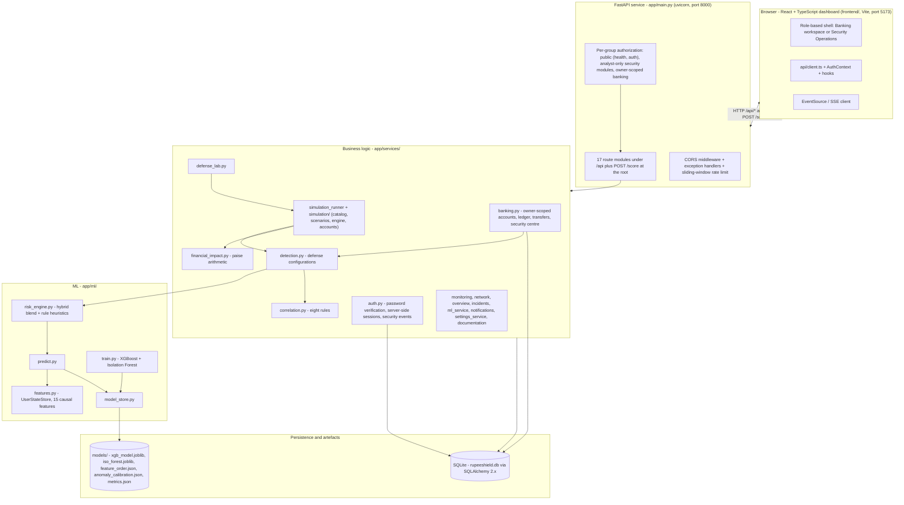
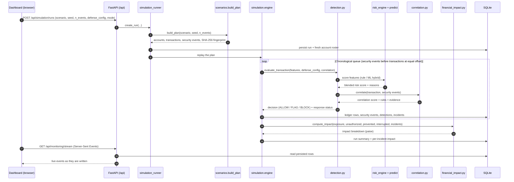

# RupeeShield — AI-Powered Financial Cybersecurity Simulation Platform

## 1. Project title and overview.

RupeeShield is an educational financial-cybersecurity cyber range. It runs a
**simulated bank** entirely on this machine: a transaction ledger, synthetic
accounts with balances, authentication and device telemetry, and four scripted
attack scenarios. A hybrid detection pipeline scores the resulting traffic, a
separate correlation component relates transactions to security events, a
financial-impact engine estimates what a simulated attack cost and what a defense
saved, and a comparison laboratory runs the same scenario under three defense
strategies.

The project is built as a real, working application rather than a UI prototype:

- A **FastAPI** backend exposes a documented HTTP API under `/api` plus the
  original direct-scoring endpoint at `POST /score`.
- A **React + TypeScript** dashboard with **two signed-in workspaces**: a *customer
  banking* experience (accounts, transaction history, simulated transfers and an
  Account Security Center) and a *security operations* console across nine areas, from
  an Overview of live statistics to a Defense Comparison Lab.
- **Local authentication with two roles** (customer and analyst), server-side
  sessions and server-enforced authorization, plus clearly-labelled demo logins.
- Both halves run locally with no paid service, no API key and no external data.
  The ML dataset is generated on this machine from a seed.

Everything the platform processes is synthetic. It never connects to a real bank,
payment network or third-party system, and it makes no real payments.

- Backend entry point: `app/main.py`
- Frontend entry point: `frontend/src/main.tsx` (shell in `frontend/src/App.tsx`)
- In-app documentation payload (served at `GET /api/docs`): `app/services/documentation.py`

## 2. Problem statement.

Fraud detection is usually taught as a single classifier evaluated offline on a
public CSV. That leaves out the parts that decide whether a real fraud system
works: how transaction behaviour is correlated with authentication and device
telemetry, how a defense trades missed fraud against interrupted legitimate
business, what an incident actually cost, and whether an extra detection layer
pays for itself once its false positives are priced in.

Those questions need a controlled environment where the ground truth is known,
the attack is reproducible, and the defensive choices can be compared on identical
inputs. RupeeShield provides that environment: a deterministic simulator that
generates a scripted attack, a detection pipeline that scores it exactly the way a
live transaction would be scored, and an impact model that separates value that
moved from value that did not.

The core question the platform exists to investigate is stated in section 4 and is
treated as a question, not as a proven result.

## 3. Objectives.

- Simulate a virtual bank and run controlled, local, deterministic attack
  scenarios against it.
- Implement a machine-learning detection pipeline with a reproducible data path and
  a causal feature-engineering step shared between training and serving.
- Implement security-event correlation as a separate, independently testable
  component, so its additional contribution can be measured rather than asserted.
- Quantify the simulated financial impact of a scenario and of a defense using
  currency-safe arithmetic, with every assumption documented.
- Compare three defense configurations on identical scenario inputs and report
  whichever one actually measured best, including cases where the extra detection
  performed worse.
- Provide an incident investigation and read-only replay workflow that never mutates
  the original records.
- Keep the whole project free, local and self-contained, and document its
  limitations honestly.

## 4. Key features.

- **Four scripted attack scenarios:** account takeover, credential stuffing,
  payment manipulation and suspicious transfer activity
  (`app/services/simulation/catalog.py`).
- **Deterministic simulation.** A scenario, a seed and an event count produce an
  identical script; each run stores a SHA-256 fingerprint so two runs can be proven
  to have received the same inputs (`app/services/simulation/scenarios.py`).
- **Hybrid detection engine** blending a supervised model, an unsupervised anomaly
  detector and auditable rules, with plain-language reasons for every decision
  (`app/ml/risk_engine.py`).
- **Causal, stateful feature engineering.** One `UserStateStore` computes the same
  15 features offline and online, so there is no train/serve skew
  (`app/ml/features.py`).
- **Eight security-event correlation rules** with configurable thresholds, evidence
  tracking and duplicate-alert suppression (`app/services/correlation.py`).
- **Server-Sent Events live monitoring** fed by persisted rows, not by frontend
  randomness (`app/api/routes/monitoring.py`).
- **Financial-network graph** of accounts and transfers, with risk labels
  (`app/services/network.py`).
- **Incident investigation and read-only replay** that recomputes decisions and
  reports divergence without editing history (`app/api/routes/incidents.py`).
- **Defense Comparison Lab** running `NONE`, `RULE_BASED` and `COMBINED` on one
  scenario script (`app/services/defense_lab.py`).
- **ML model evaluation** with stored metrics, confusion matrices, PR curves,
  feature importance and live inference latency (`app/services/ml_service.py`).
- **Financial-impact engine** using integer paise and `Decimal`, with documented
  formulas and assumptions (`app/services/financial_impact.py`).
- **Audit logging and validation** on the boundary; a sliding-window rate limiter on
  every `/api` route (`app/security/audit.py`, `app/security/validation.py`,
  `app/security/ratelimit.py`).
- **Virtual banking experience** for the customer side: a signed-in dashboard with
  account cards and balances read from the database, a filterable transaction
  history with detail views, a simulated transfer flow that scores through the real
  detection pipeline, and an Account Security Center (`app/services/banking.py`,
  `frontend/src/pages/`).
- **Local authentication and two roles** with server-side sessions and
  server-enforced authorization (`app/services/auth.py`, `app/api/__init__.py`).
- **Notification centre fed by stored events** rather than frontend timers
  (`app/services/notifications.py`).

### Virtual banking experience and roles.

The platform has two signed-in roles. Both are real, backend-enforced roles, not
labels on a page:

| Role | Sees | Backend scope |
|---|---|---|
| **Customer** | Their own accounts, balances, transaction history, transfer flow and security centre | `banking` routers are scoped to the signed-in owner inside the service; a customer cannot widen that scope with a query parameter |
| **Security Analyst** | The nine security-operations areas (overview, simulator, monitoring, explorer, network, incidents, defense, model, settings) | The security modules require an `ANALYST` session; a customer token is refused with `403` |

Authorization is applied by router group in `app/api/__init__.py` and re-checked on
every request, so hiding a navigation item in the browser is never the thing that
protects a resource. A customer's ledger and the analyst's transaction explorer read
the same `transactions` rows, and a scenario launched by an analyst writes events
that appear on the customer's security page — see section 9 for the shared schema.

### Authentication approach.

- **Passwords are never stored in plaintext.** Set and verified with a stdlib
  `hashlib.pbkdf2_hmac` (`pbkdf2_sha256$<iterations>$<salt>$<digest>`,
  `RUPESHIELD_PASSWORD_ITERATIONS` default `180000`) in `app/security/passwords.py`.
- **Sessions are server-side.** Sign-in mints an opaque `secrets.token_urlsafe(32)`
  token; only its SHA-256 digest is written to `auth_sessions`, with an expiry of
  `RUPESHIELD_SESSION_TTL_MINUTES` (default 120). The browser stores the token under
  `rupeeshield.session.token` and sends it as `Authorization: Session <token>`
  (also accepted: `Bearer`, or `X-Session-Token`).
- **Failures are indistinguishable.** An unknown email and a wrong password return
  the same message, so sign-in cannot be used to enumerate accounts.
- **Protected routes and logout.** The dashboard resolves the token before rendering
  a route, sends unauthenticated visitors to `/login`, and `POST /api/auth/logout`
  revokes the session server-side. Sign-in attempts, including failures, are recorded
  as security events and can raise a notification.
- **No hardcoded production secrets.** The only credentials in the repository are the
  clearly-labelled local demo logins (section 12), which are created only while demo
  mode is enabled and are hashed at rest like any other.

### Attack scenarios

All four scenarios are defined as data in `app/services/simulation/catalog.py` and
scripted by `app/services/simulation/scenarios.py`.

| Key | Name | Risk level | Default events | Objective |
|---|---|---|---|---|
| `ACCOUNT_TAKEOVER` | Account takeover | HIGH | 40 | Move value out of a hijacked account before anyone notices |
| `CREDENTIAL_STUFFING` | Credential stuffing | HIGH | 60 | Find working credentials at scale and cash out quickly |
| `PAYMENT_MANIPULATION` | Payment manipulation | MEDIUM | 30 | Redirect a legitimate payment without changing the total |
| `SUSPICIOUS_TRANSFER` | Suspicious transfer activity | MEDIUM | 35 | Obscure the origin of funds by fanning them out |

### The research question under study

> Does combining transaction anomaly detection with security-event correlation
> reduce simulated financial losses compared with transaction-only detection?

The platform is built to investigate this question, not to assert an answer. The
Defense Comparison Lab runs one scenario script under three configurations and
reports the measured net simulated impact. The comparison reports whichever
configuration actually measured best and explains cases where the combined
approach performed worse. A single scenario and seed is one data point; several
seeds are needed before any difference can be read as a general result. The
hypothesis is **not** treated as proven.

## 5. Scope and safety limitations.

RupeeShield is a simulation and must never be presented as a production-grade
banking security system.

- It contains no offensive capability. It cannot attack, scan, probe or degrade any
  external system, and it targets nothing outside its own local database.
- Every "attack" is a locally generated scenario script executed against a
  synthetic bank inside the same process.
- All accounts, transactions, devices, merchants and security events are synthetic.
  No real personal or financial data is stored, processed or displayed.
- Accounts are never described as criminal. The strongest labels used anywhere are
  **"flagged for investigation"** and **"elevated simulated risk"**.
- Ground-truth fraud labels come from the scenario generator, so every precision and
  recall figure is a measurement against a known answer, not a claim about
  real-world performance.
- The application ships a local authentication and role model (customer vs analyst),
  but it is **not** a hardened, multi-tenant deployment: there is no HTTPS, no
  password reset, no external identity provider and no protection against an
  attacker who already has the machine. The in-memory feature store is per-process
  and is not shared between replicas (`app/api/routes/score.py`).
- The banking side is a **simulator**. Balances, payees and "money" exist only as
  rows in a local SQLite file; a transfer moves rows, not funds. There is no
  settlement, no interest, no fees and no real payment rail.
- All financial figures are modelled estimates from a synthetic scenario, not audited
  financial statements.

## 6. Technology stack and reasons for choosing it.

| Layer | Choice | Why |
|---|---|---|
| Backend | Python 3.12, FastAPI 0.115.6, Uvicorn 0.34.0 | Async HTTP, automatic OpenAPI docs, and Pydantic validation at the boundary |
| Configuration | Pydantic v2 `BaseSettings` / pydantic-settings | Typed configuration, environment-variable overrides, no secrets in source |
| Database | SQLite via SQLAlchemy 2.x | No server, no credentials, no cost; a single file keeps the project self-contained |
| ML | scikit-learn 1.7.2, XGBoost 2.0.3 | A supervised classifier for known typologies plus an unsupervised detector for novel ones |
| Explainability | SHAP (optional) | Per-transaction feature contributions; absent without breaking scoring |
| Data | pandas 2.3.3, NumPy | Schema validation, temporal splitting and reproducible generation |
| Frontend | React 18.3 + TypeScript 5.6 (strict) + Vite 5 | Type-safe SPA with a fast dev server and a built-in dev proxy |
| Routing | react-router-dom 6 | Role-based routes and a URL that survives a refresh |
| Auth | stdlib `hashlib` + `secrets` | PBKDF2 password hashing and opaque session tokens with no extra dependency |
| Charts | Recharts 2.12 | React-native charting for the dashboards |
| Graph | Cytoscape 3.30 | Purpose-built graph rendering for the financial network |
| Frontend tests | Vitest 2.1 + jsdom + Testing Library | The Vite-native test runner, so one toolchain for build and test |
| Backend tests | pytest 8.3 + httpx | Standard Python testing with an in-process `TestClient` |
| CI | GitHub Actions | Free for public repositories; runs backend and frontend jobs |

Every dependency is free and open source, and the whole stack runs locally with no
external service or API key. The pinned versions are listed in `requirements.txt`
and `frontend/package.json`.

## 7. Architecture diagram using Mermaid.



Request routing is intentionally thin. `app/api/__init__.py` mounts one aggregate
router at `/api` with the rate limiter applied once; `app/main.py` mounts the
scoring router at the root. Authorization is applied in the same file by grouping
routers — public (health, sign-in), analyst-only security modules, owner-scoped
banking, and notifications for any signed-in role — so a role check is a property of
the router group rather than something each handler remembers to do. Business logic
lives in `app/services/`, persistence in `app/db/`, and ML training is separate from
inference (`app/ml/train.py` versus `app/ml/predict.py`).

## 8. Repository directory structure.

```text
Real-Time-Fraud-Detection-Anomaly-Intelligence-Platform/
├── app/                          # FastAPI backend
│   ├── api/
│   │   ├── routes/               # 17 route modules + score.py (see section 7)
│   │   ├── deps.py               # identity dependencies, SessionDep, client_host, rate limit
│   │   ├── errors.py             # 401 / 403 / 422 / 404 / 409 exception mapping
│   │   └── __init__.py           # aggregate /api router + per-group authorization
│   ├── core/                     # config.py (settings), logging.py
│   ├── db/
│   │   ├── models.py             # 17 tables (users, accounts, transactions, ...)
│   │   ├── seed.py               # demo bank seeder (CLI: python -m app.db.seed)
│   │   ├── session.py            # engine + init_db
│   │   └── repositories/         # query helpers (owner-scoped account queries)
│   ├── ml/
│   │   ├── dataset.py            # schema validation + provenance
│   │   ├── synthetic_data.py     # seeded dataset generator
│   │   ├── features.py           # causal UserStateStore + FEATURE_ORDER
│   │   ├── preprocessing.py      # feature table, cleaning, temporal split
│   │   ├── risk_engine.py        # hybrid blend + rule heuristics
│   │   ├── train.py              # XGBoost + Isolation Forest + calibration
│   │   ├── predict.py            # serving-side predictor
│   │   ├── evaluate.py           # metrics, PR curves, importance, latency
│   │   └── model_store.py        # artefact load/save
│   ├── schemas/                  # Pydantic request/response models
│   ├── security/                 # passwords.py, access.py, validation.py, ratelimit.py, audit.py
│   ├── services/
│   │   ├── simulation/           # accounts.py, catalog.py, scenarios.py, engine.py
│   │   ├── auth.py               # password verification, sessions, sign-in events
│   │   ├── banking.py            # owner-scoped accounts, ledger, transfers, security centre
│   │   ├── notifications.py      # per-role notification feed
│   │   ├── correlation.py        # eight correlation rules
│   │   ├── defense_lab.py        # three-configuration comparison
│   │   ├── detection.py          # maps a configuration onto scoring
│   │   ├── financial_impact.py   # impact formulas (paise)
│   │   ├── incidents.py          # incident detail + replay
│   │   ├── monitoring.py         # event feed + SSE
│   │   ├── network.py            # graph construction
│   │   ├── overview.py           # overview statistics
│   │   ├── ml_service.py         # model info / evaluation
│   │   ├── settings_service.py   # threshold overrides
│   │   ├── simulation_runner.py  # run lifecycle
│   │   └── documentation.py      # in-app documentation payload
│   ├── utils/                    # money.py, timeutils.py, ids.py
│   └── main.py                   # FastAPI app
├── frontend/                     # React + TypeScript dashboard (Vite)
│   ├── src/
│   │   ├── api/                  # client.ts, session.ts, types.ts
│   │   ├── auth/                 # AuthContext.tsx, ProtectedRoute.tsx
│   │   ├── components/           # ui.tsx, banking.tsx, shell.tsx, notifications.tsx, ...
│   │   ├── hooks/                # useApiResource.ts
│   │   ├── lib/                  # format.ts
│   │   ├── pages/                # 15 page components (banking + security)
│   │   ├── styles/               # theme.css
│   │   ├── App.tsx               # role-based shell + routes
│   │   └── main.tsx
│   ├── package.json
│   └── vite.config.ts
├── models/                       # trained artefacts (checked in)
├── scripts/
│   └── generate_dataset.py       # synthetic dataset CLI
├── tests/                        # pytest suite (services, API, ML, money, banking)
├── .github/workflows/ci.yml      # backend + frontend CI
├── .env.example                  # documented environment variables
├── Dockerfile                    # single-service API image
├── docker-compose.yml            # local compose stack (API only)
├── requirements.txt
└── LICENSE
```

## 9. Data flow and system workflow.

The sequence below is the full path a simulation takes, from the browser request to
the persisted impact figures and the live feed.



Two decisions shape this flow:

- **The plan is separate from the run.** `build_plan` depends only on
  `(scenario, seed, n_events)` and contains no run identifier, database row or
  defense setting. That is what lets the Defense Comparison Lab replay one script
  under three defenses and attribute any difference to the defense alone.
- **Correlation never lowers risk.** It is an additive boost applied on top of the
  transaction score, clamped to 1.0, so it can push a borderline transaction over a
  threshold but can never mark something as safe.

### Detection pipeline

The hybrid risk engine (`app/ml/risk_engine.py`) blends three independent signals,
each covering a different failure mode:

```text
final_risk = 0.55 x ml_supervised    # XGBoost: known fraud typologies
           + 0.25 x ml_anomaly       # Isolation Forest: novel patterns
           + 0.20 x rule_heuristic   # auditable guardrails
```

When the ML components are unavailable (`RULE_BASED`), the rule score *is* the risk
score and the ML components are reported as `null` rather than fabricated
(`combine_scores`, `score_transaction`).

The rule heuristics add fixed increments, clamped to 1.0:

| Rule id | Adds | Fires when |
|---|---|---|
| `R-HIGH-VELOCITY-10MIN` | 0.35 | `txns_last_10min` reaches the 10-minute velocity threshold |
| `R-HIGH-VELOCITY-1H` | 0.20 | `txns_last_1h` reaches the 1-hour threshold (else-branch of the above) |
| `R-RAPID-REPEAT` | 0.15 | Under 0.5 minutes since the previous transaction and more than one in 10 minutes |
| `R-AMOUNT-OUTLIER` | 0.30 | `amount_zscore` above the z-score threshold |
| `R-AMOUNT-MULTIPLE-OF-AVG` | 0.15 | `amount_over_user_avg` above the multiple-of-average threshold |
| `R-NEW-DEVICE-AND-COUNTRY` | 0.30 | Both a new device and a new country |
| `R-NEW-COUNTRY` | 0.15 | New country only |
| `R-NEW-DEVICE` | 0.10 | New device only |
| `R-LATE-NIGHT-LARGE` | 0.10 | Late-night transaction with amount above twice the account average |

### Decision classes and thresholds

`decide()` maps the final risk score to one of three classes, and each class maps to
a ledger/response status (`app/services/detection.py`, `RESPONSE_BY_DECISION`):

| Class | Condition | Response status |
|---|---|---|
| `BLOCK` | score >= `block_threshold` (0.80) | `BLOCKED` |
| `FLAG` | score >= `flag_threshold` (0.45) and below block | `PENDING_REVIEW` |
| `ALLOW` | below the flag threshold | `SETTLED` |

### Feature engineering

Fifteen causal features are computed by a single `UserStateStore`
(`app/ml/features.py`, `FEATURE_ORDER`), read-then-update so a transaction never
sees itself. Rolling amount statistics use Welford's online algorithm.

```text
amount, hour, day_of_week, is_weekend, is_late_night, time_since_prev_txn_min,
txns_last_10min, txns_last_1h, txns_last_24h, user_avg_amount,
amount_over_user_avg, amount_zscore, is_new_device, is_new_country,
is_channel_switch
```

The same class and the same feature order are used offline (training replay) and
online (serving), which removes offline/online feature mismatch by construction.
`models/feature_order.json` is validated against `FEATURE_ORDER` at load time.

### Security-event correlation rules

Correlation is a separate, pure function (`app/services/correlation.py`) that
evaluates eight readable rules over the security events that occurred before and
around one transaction. Weights are additive and clamped at 1.0; correlation only
raises risk.

| Rule id | Weight | Meaning |
|---|---|---|
| `C-FAILED-LOGIN-BURST` | 0.45 | Repeated failed logins immediately before the transaction |
| `C-CREDENTIAL-COMPROMISE` | 0.30 | A login from an unusual place or device preceded the transaction |
| `C-NEW-DEVICE-HIGH-VALUE` | 0.30 | A previously unseen device used for a high-value transaction |
| `C-PAYMENT-TAMPERING` | 0.40 | Payment details changed shortly before the transaction |
| `C-COORDINATED-FANOUT` | 0.35 | Money being spread across several new beneficiaries at once |
| `C-SHARED-DEVICE` | 0.35 | The same device is active on more than one account |
| `C-MULE-FUNDING` | 0.35 | An incoming wire immediately followed by outgoing transfers |
| `C-CARD-TESTING` | 0.25 | A burst of tiny probe transactions precedes this one |

The boost is applied additively in the `COMBINED` configuration as
`min(transaction_risk + 0.5 x correlation_score, 1.0)` (`CORRELATION_BOOST = 0.5`).
Every rule records the ids of the events that triggered it, and
`dedupe_alerts` collapses repeats for the same (account, rule) inside a 15-minute
window so a burst of failures is one alert, not dozens.

### Defense configurations

`app/services/detection.py` (`DEFENSE_CONFIGS`) defines the three configurations
used by the Defense Comparison Lab:

| Key | Uses ML | Uses correlation | Meaning |
|---|---|---|---|
| `NONE` | No | No | No automated defense; every transaction settles (score 0, `ALLOW`) |
| `RULE_BASED` | No | No | Heuristics only |
| `COMBINED` | Yes | Yes | Rules + supervised ML + anomaly detection + correlation |

`COMBINED` requires the trained artefacts; without them the simulation engine
downgrades a run to rule-only and says so, while the API returns `409`.

### Data provenance and determinism

- **Synthetic generator.** `app/ml/synthetic_data.py` produces the ML dataset with
  four named typologies (`CARD_TESTING`, `ACCOUNT_TAKEOVER`, `MULE_FANOUT`,
  `MERCHANT_COLLUSION`), seeded with `RNG_SEED = 42`.
- **Scenario determinism.** `app/services/simulation/scenarios.py` builds its plan
  with `numpy.random.default_rng(seed)` and stores
  `sha256(canonical_json)[:16]` as the run fingerprint.
- **No real customer data.** The dataset is generated locally; PaySim is supported
  only as an optional bring-your-own file and contains no cybersecurity labels.
- **Seeds.** The default seed is `42` (`RUPESHIELD_DEFAULT_SEED`); tests use
  `4242` (`tests/conftest.py`).

### Database entities and relationships

`app/db/models.py` defines 17 SQLAlchemy tables. The conceptual entities named in the
specification map onto them; the rest are the simulation and ML records the platform
already needed.

| Entity | Table | Notes |
|---|---|---|
| User | `users` | `role` is `CUSTOMER` or `ANALYST`; email is unique; the password column holds a PBKDF2 hash, never plaintext |
| CustomerProfile | `customer_profiles` | One-to-one with a customer `User` (display name, contact, segment) |
| BankAccount | `accounts` | `user_id` is nullable — a scenario roster is not a customer; `kind` is `CUSTOMER` or `PAYEE`; balance is integer minor units |
| Transaction | `transactions` | `account_id` plus optional `counterparty_id`, optional `run_id`, signed `amount_minor`, `status` |
| SecurityEvent | `security_events` | Belongs to an `account_id`; optional `run_id` and `incident_id`; carries kind, severity, device and country |
| SecurityIncident | `incidents` | Groups its timeline in `incident_events`; carries an optional `run_id` |
| DetectionResult | `detection_results` | One scored decision per transaction: risk score, decision, reasons, correlation rules, SHAP evidence |
| Notification | `notifications` | Optional `user_id` plus `kind` and an entity type/id that point at a real event or transfer |
| AuditLog | `audit_logs` | Append-only; action and actor only, no passwords or tokens |
| AuthSession | `auth_sessions` | Server-side session; the token is stored only as a SHA-256 digest, with issue and expiry times |
| Simulation | `simulation_runs`, `replay_runs`, `defense_actions`, `financial_impacts`, `defense_comparisons`, `model_versions` | Existing scenario, replay, defense and ML bookkeeping |

Relationships that carry the banking ↔ security link:

- A customer `User` owns one `CustomerProfile`, many `AuthSession`s and many
  `Notification`s, and is the `owner` (`accounts.user_id`) of its `BankAccount`s.
- A `BankAccount` appears as `account_id` on its own rows and as `counterparty_id` on
  the other side of a transfer, so both legs of one movement are rows in the same
  table.
- A `Transaction` has one `DetectionResult` and, when it was raised by an attack
  scenario, an optional `run_id`.
- A `SecurityEvent` belongs to one `BankAccount` and may belong to one `Incident`;
  that incident then owns its `IncidentEvent` timeline and its `FinancialImpact`
  figures.
- Because the customer's ledger and the analyst's console read the same `transactions`,
  `security_events` and `incidents` rows, a scenario and a transfer show up on both
  sides with the same identifiers — there is no second, page-specific copy.

## 10. Dataset source, license, schema, and limitations.

The ML dataset is generated locally by this project. Provenance is defined in
`app/ml/dataset.py` (`DATASET_SOURCES`) and surfaced through `GET /api/docs`.

| Source | URL | License | Cybersecurity labels |
|---|---|---|---|
| Synthetic (default) | Generated locally — see `app/ml/synthetic_data.py` | MIT (same as this repository) | No — labels come from the generator |
| PaySim (optional) | https://www.kaggle.com/datasets/ealaxi/paysim1 | CC BY-SA 4.0 (check the Kaggle page for authoritative terms) | No — transaction columns only |

### Schema

Required columns (`app/ml/dataset.py`, `REQUIRED_COLUMNS`):

`transaction_id`, `user_id`, `timestamp`, `amount`, `channel`, `country`,
`merchant_id`, `device_id`, `is_fraud`, `fraud_type`

Amounts are in major units (INR) in the CSV and are converted to integer paise
internally. `is_fraud` is nullable ground truth that always originates from the
scenario/dataset generator, never from the detector.

### Limitations

- The synthetic dataset is entirely artificial: distributions are designed, not
  observed from a real bank.
- Fraud typologies are injected deliberately, so a model can learn them almost
  perfectly; metrics on this data are an **upper bound**, not a real-world estimate.
- The dataset carries no authentication, device or geo telemetry, so it cannot
  measure the contribution of security-event correlation; that is evaluated in the
  Defense Comparison Lab.
- PaySim is simulated (multi-agent), provides one step per hour (coarse sub-hour
  velocity) and is extremely imbalanced (about 0.13% fraudulent rows).
- Large datasets and any sensitive data are kept out of Git; `data/` is not
  committed.

## 11. Installation prerequisites.

> Setting the project up on a new machine for the first time? Follow the
> step-by-step **[INSTALL.md](INSTALL.md)** guide, which covers Windows, macOS and
> Linux, the Docker alternative and a troubleshooting table. This section is the
> short version.

- **Python 3.12** (used by both the CI workflow and the Docker image).
- **Node.js 20** and npm, for the dashboard.
- **Git**, and optionally **Docker** with the Compose plugin.
- No Java, no message broker, no external database and no API key.

Run the backend from a virtual environment. On Windows PowerShell:

```powershell
python -m venv .venv
.venv\Scripts\Activate.ps1
pip install -r requirements.txt
```

On macOS or Linux:

```bash
python -m venv .venv
source .venv/bin/activate
pip install -r requirements.txt
```

## 12. Step-by-step local setup.

From the repository root:

```bash
# 1. Install backend dependencies (see section 11 for the venv step)
pip install -r requirements.txt

# 2. (Optional) copy the environment template; defaults work with no .env at all
cp .env.example .env

# 3. Generate the synthetic ML dataset
python scripts/generate_dataset.py --n-users 800 --n-transactions 40000

# 4. Train the detection models (writes artefacts into models/)
python -m app.ml.train

# 5. Seed the demo bank: the customer, their accounts, payees, transaction
#    history, sign-in telemetry, one scored probe payment and its incident.
#    Safe to re-run — it does nothing once the demo data exists.
python -m app.db.seed

# 6. Start the backend (port 8000)
uvicorn app.main:app --reload --port 8000

# 7. In a second terminal, install and start the dashboard (port 5173)
npm --prefix frontend install
npm --prefix frontend run dev
```

Then open:

- Dashboard: http://localhost:5173
- Interactive API docs: http://127.0.0.1:8000/docs

The dashboard opens on the sign-in page. Sign in with a demo login:

| Role | Email | Password |
|---|---|---|
| Customer | `priya.sharma@rupeeshield.demo` | `demo-customer-2026` |
| Security Analyst | `analyst@rupeeshield.demo` | `demo-analyst-2026` |

These are **fictional local demo credentials**. They are created only while
`RUPESHIELD_DEMO_MODE_ENABLED` is true (the default), published by
`GET /api/auth/demo-credentials` so the sign-in page can label the demo buttons, and
stored as PBKDF2 hashes — never as plaintext. Change or disable them through
environment variables (section 13) before sharing a machine, because the passwords
above are in this document.

Alternatively, run the backend alone in Docker:

```bash
docker compose up --build
```

The `models/` directory already contains trained artefacts, so step 4 is only
needed after changing the dataset or the feature set. Steps 3 and 4 are required
for the `COMBINED` defense configuration to run (see section 23). Step 5 (the seed)
is what gives the sign-in page an account to sign in with; without it the demo
logins exist but the demo customer has no accounts or ledger to show.

## 13. Environment variable configuration.

Configuration lives in `app/core/config.py`. Every setting can be overridden with an
environment variable prefixed `RUPESHIELD_`, or through a `.env` file at the
repository root (which is git-ignored). Defaults are chosen so the project runs with
no configuration at all. Nested threshold values use a double underscore
(`env_nested_delimiter="__"`). The authoritative, commented list is `.env.example`.

| Variable | Default | Meaning |
|---|---|---|
| `RUPESHIELD_APP_NAME` | `RupeeShield` | Service name shown in the API |
| `RUPESHIELD_ENVIRONMENT` | `local` | Environment label (`local`, `docker`, `test`) |
| `RUPESHIELD_LOG_LEVEL` | `INFO` | Logging level |
| `RUPESHIELD_DATABASE_URL` | `sqlite:///<repo>/rupeeshield.db` | SQLAlchemy database URL |
| `RUPESHIELD_MODEL_DIR` | `models` | Where model artefacts are read/written |
| `RUPESHIELD_DATA_DIR` | `data` | Where the dataset and overrides live |
| `RUPESHIELD_CORS_ORIGINS` | `["http://localhost:5173","http://127.0.0.1:5173"]` | Browser origins allowed to call the API |
| `RUPESHIELD_DEFAULT_SEED` | `42` | Default simulation seed |
| `RUPESHIELD_MAX_SIMULATION_EVENTS` | `1500` | Runaway guard for one simulation |
| `RUPESHIELD_MAX_BATCH_EVENTS` | `6000` | Runaway guard for batch runs |
| `RUPESHIELD_DEFAULT_STREAM_PACE_PER_SECOND` | `12` | Default stream rate for `mode=stream` |
| `RUPESHIELD_MAX_PAGE_SIZE` | `500` | Maximum list page size |
| `RUPESHIELD_RATE_LIMIT_REQUESTS_PER_MINUTE` | `240` | Sliding-window limit for `/api` routes |
| `RUPESHIELD_ENABLE_API_TRAINING` | `false` | Enables `POST /api/ml/train` (command-line training is the documented workflow) |
| `RUPESHIELD_SESSION_TTL_MINUTES` | `120` | How long a sign-in session stays valid before it expires |
| `RUPESHIELD_PASSWORD_MIN_LENGTH` | `8` | Shortest accepted password when a password is set |
| `RUPESHIELD_PASSWORD_ITERATIONS` | `180000` | PBKDF2-HMAC-SHA256 iteration count for stored password hashes |
| `RUPESHIELD_MAX_FAILED_LOGINS` | `5` | Failed sign-ins within the burst window that raise a security event |
| `RUPESHIELD_DEMO_MODE_ENABLED` | `true` | Creates and publishes the two demo logins; set `false` to remove them |
| `RUPESHIELD_DEMO_CUSTOMER_EMAIL` | `priya.sharma@rupeeshield.demo` | Demo customer sign-in email |
| `RUPESHIELD_DEMO_CUSTOMER_PASSWORD` | `demo-customer-2026` | Demo customer password (hashed at rest) |
| `RUPESHIELD_DEMO_ANALYST_EMAIL` | `analyst@rupeeshield.demo` | Demo analyst sign-in email |
| `RUPESHIELD_DEMO_ANALYST_PASSWORD` | `demo-analyst-2026` | Demo analyst password (hashed at rest) |
| `RUPESHIELD_TRANSFER_MIN_MINOR` | `100` | Smallest transfer in paise (1.00 INR) |
| `RUPESHIELD_TRANSFER_MAX_MINOR` | `20000000` | Largest single transfer in paise (200,000.00 INR) |
| `RUPESHIELD_TRANSFER_DAILY_LIMIT_MINOR` | `50000000` | Daily transfer ceiling per customer in paise (500,000.00 INR) |
| `RUPESHIELD_THRESHOLDS__BLOCK_THRESHOLD` | `0.80` | Risk score at or above which a transaction is blocked |
| `RUPESHIELD_THRESHOLDS__FLAG_THRESHOLD` | `0.45` | Risk score at or above which a transaction is held for review |
| `RUPESHIELD_THRESHOLDS__RULE_VELOCITY_10MIN` | `5` | Velocity rule threshold (10 minutes) |
| `RUPESHIELD_THRESHOLDS__RULE_VELOCITY_1H` | `8` | Velocity rule threshold (1 hour) |
| `RUPESHIELD_THRESHOLDS__RULE_AMOUNT_ZSCORE` | `4.0` | Amount z-score rule threshold |
| `RUPESHIELD_THRESHOLDS__RULE_AMOUNT_OVER_AVG` | `5.0` | Amount-over-average rule threshold |
| `RUPESHIELD_THRESHOLDS__FAILED_LOGIN_BURST` | `5` | Failed logins needed to trigger the burst rule |
| `RUPESHIELD_THRESHOLDS__FAILED_LOGIN_WINDOW_MINUTES` | `10` | Window for the failed-login burst |
| `RUPESHIELD_THRESHOLDS__CORRELATION_LOOKBACK_MINUTES` | `30` | How far back correlation looks for security events |
| `RUPESHIELD_THRESHOLDS__NEW_DEVICE_HIGH_VALUE_MINOR` | `40000` | New-device high-value threshold in paise (400.00 INR) |
| `RUPESHIELD_THRESHOLDS__COORDINATED_FANOUT_BENEFICIARIES` | `3` | Distinct new beneficiaries that trigger the fan-out rule |

Thresholds can also be changed at runtime through `PATCH /api/settings`; overrides
are persisted to a git-ignored `thresholds.json` in the data directory
(`app/services/settings_service.py`) and validated so that the flag threshold stays
below the block threshold. No secret is required by any setting, so nothing secret
can leak through configuration.

## 14. Dataset preparation.

Generate the dataset with the CLI wrapper around `app/ml/synthetic_data.py`:

```bash
# Full default: 4,000 accounts, 250,000 transactions, 1.2% fraud, seed 42
python scripts/generate_dataset.py

# A faster run suitable for a laptop or CI
python scripts/generate_dataset.py --n-users 800 --n-transactions 40000

# The small, committed sample used for first-time setup (300 accounts / 12k rows / 2%)
python scripts/generate_dataset.py --sample
```

Outputs:

- `data/transactions.csv` — the ML dataset (validated against `REQUIRED_COLUMNS`).
- `data/users.csv` — the synthetic account profiles behind it.

The generator is seeded, so anyone can regenerate identical data. Neither CSV is
committed. To use PaySim instead, download it yourself and point training at it with
`--paysim` (see section 15).

## 15. ML model training.

```bash
python -m app.ml.train
```

`app/ml/train.py` performs the full pipeline:

1. Loads and validates the dataset (`load_transactions_csv`).
2. Handles invalid rows: non-numeric amounts, missing timestamps and non-positive
   amounts are dropped (`clean_feature_frame`).
3. Builds the feature table using the same causal `UserStateStore` used at serving
   time (`build_feature_table`).
4. Splits **temporally** — the earlier 75% for training, the later 25% for testing —
   because a random split would leak post-fraud-burst behaviour into training.
5. Trains **XGBoost** (`n_estimators=400`, `max_depth=5`, `learning_rate=0.05`,
   `subsample=0.85`, `colsample_bytree=0.85`, minority class weighted,
   `eval_metric="aucpr"`) using the tail of the training window for early stopping.
6. Trains an **Isolation Forest** (`n_estimators=300`, `contamination=0.02`) on
   legitimate rows only.
7. Computes anomaly-score calibration (the p50 and p99 of the Isolation Forest
   score on legitimate training data) and writes it to
   `models/anomaly_calibration.json`.
8. Evaluates `rule_based`, `transaction_only`, `combined` and `anomaly_only` slices
   on the same held-out test window.
9. Saves artefacts and metrics, then registers model versions in the database
   (skippable with `--no-register`).

Artefacts written to `models/` (`app/ml/model_store.py`):

| File | Purpose |
|---|---|
| `xgb_model.joblib` | Supervised classifier |
| `iso_forest.joblib` | Unsupervised anomaly detector |
| `feature_order.json` | Exact feature order the models were trained with |
| `anomaly_calibration.json` | p50 / p99 of the anomaly score on legitimate data |
| `metrics.json` | Metrics measured at training time (read by the API, not recomputed) |
| `training_summary.json` | Compact summary (combined, isolation_forest, rule_based) |

Useful flags: `--transactions`, `--model-dir`, `--test-fraction`, `--paysim`,
`--no-register`. The `feature_order.json` guard fails loudly if the stored order ever
diverges from `FEATURE_ORDER`, because the model would otherwise score the wrong
columns.

## 16. Backend startup.

```bash
uvicorn app.main:app --reload --port 8000
```

Endpoints for verification:

- Interactive OpenAPI docs: http://127.0.0.1:8000/docs
- ReDoc: http://127.0.0.1:8000/redoc
- Health check: http://127.0.0.1:8000/api/health
- Service index at the root: `GET /` returns the version and links.

On startup the app configures logging, creates any missing SQLite tables and
registers routers. Model artefacts are loaded lazily by the detection service on
first use, so the API boots and answers `/api/health` even before training has run.

The HTTP surface is grouped below. All paths are relative to the host; the scoring
endpoint is mounted at the root, everything else under `/api`.

| Module | Method and path | Purpose |
|---|---|---|
| System | `GET /api/health` | Liveness, tracked accounts, models loaded |
| Docs | `GET /api/docs` | In-app documentation payload |
| A — Overview | `GET /api/overview` | Overview statistics, provenance-labelled |
| B — Simulator | `GET /api/scenarios` | Scenario catalogue |
| B — Simulator | `GET /api/simulation/runs` | List runs (paged, filterable by scenario) |
| B — Simulator | `POST /api/simulation/runs` | Start a run (201; `mode=batch` or `stream`) |
| B — Simulator | `GET /api/simulation/runs/{run_id}` | Run detail |
| B — Simulator | `POST /api/simulation/runs/{run_id}/stop` | Stop a run (idempotent) |
| B — Simulator | `DELETE /api/simulation/runs/{run_id}` | Delete a run and everything derived from it |
| C — Monitoring | `GET /api/monitoring/events` | Persisted event feed (paged) |
| C — Monitoring | `GET /api/monitoring/stream` | Server-Sent Events stream for one run |
| Explorer | `GET /api/transactions` | Transaction ledger (paged) |
| Explorer | `GET /api/transactions/{transaction_id}` | One transaction with its detection |
| Explorer | `GET /api/accounts` | Simulated account roster |
| Explorer | `GET /api/accounts/{account_id}` | One account |
| Explorer | `GET /api/accounts/{account_id}/events` | Security events for one account |
| F — Network | `GET /api/network/graph` | Account/transfer graph |
| H — Incidents | `GET /api/incidents` | Incident queue |
| H — Incidents | `GET /api/incidents/{incident_id}` | Full incident detail |
| H — Incidents | `PATCH /api/incidents/{incident_id}/status` | Update incident status |
| H — Incidents | `POST /api/incidents/{incident_id}/notes` | Add an investigation note |
| H — Incidents | `POST /api/incidents/{incident_id}/replay` | Read-only replay of recorded events |
| I — Defense | `GET /api/defense/configs` | The three defense configurations |
| I — Defense | `POST /api/defense/compare` | Run one scenario under all three defenses |
| I — Defense | `GET /api/defense/comparisons` | Past comparisons |
| D/J — ML | `GET /api/ml/model-info` | Artefacts on disk, versions, setup instructions |
| D/J — ML | `GET /api/ml/evaluation` | Stored metrics, PR curves, latency |
| D/J — ML | `GET /api/ml/feature-importance` | Gain-based feature importance |
| D/J — ML | `POST /api/ml/train` | Retrain in-process (gated by `RUPESHIELD_ENABLE_API_TRAINING`) |
| K — Settings | `GET /api/settings` | Current configuration and thresholds |
| K — Settings | `PATCH /api/settings` | Update thresholds (validated) |
| K — Audit | `GET /api/audit` | Audit log, newest first |
| Auth | `POST /api/auth/login` | Sign in; records the attempt and issues a server-side session |
| Auth | `GET /api/auth/session` | Resolve the presented token (401 when expired or revoked) |
| Auth | `POST /api/auth/logout` | Revoke the presented session |
| Auth | `POST /api/auth/logout-all` | Revoke every session for the signed-in user |
| Auth | `GET /api/auth/demo-credentials` | Publish the demo logins (only while demo mode is on) |
| Notifications | `GET /api/notifications` | Your notifications plus the unread count (customer- or analyst-scoped) |
| Notifications | `GET /api/notifications/unread-count` | Unread badge count |
| Notifications | `POST /api/notifications/{notification_id}/read` | Mark one notification read |
| Notifications | `POST /api/notifications/read-all` | Mark every notification read |
| Banking | `GET /api/banking/accounts` | The signed-in customer's own accounts and balances |
| Banking | `GET /api/banking/accounts/{account_id}` | One owned account with its recent activity |
| Banking | `GET /api/banking/payees` | Beneficiaries the customer may transfer to |
| Banking | `GET /api/banking/transactions` | Own ledger (search, date range, account, type, status, suspicious, paged) |
| Banking | `GET /api/banking/transactions/{transaction_id}` | Own transaction with detection evidence and incident links |
| Banking | `POST /api/banking/transfers` | Simulated transfer: validates, scores through the real pipeline, moves money atomically |
| Banking | `GET /api/banking/security-centre` | Account Security Center: posture, sign-ins, devices, suspicious rows, incidents |
| Banking | `POST /api/banking/security-centre/simulate-login` | Raise a real "new sign-in" security event for the customer |
| Scoring | `POST /score` | Score one transaction with the `COMBINED` configuration |

### HTTP error mapping

`app/api/errors.py` maps service exceptions to meaningful status codes and a
`{ "detail", "code" }` payload: validation errors become `422`, missing resources
become `404`, and a detection request that needs absent ML artefacts becomes `409`.
Rate-limited requests return `429` with a `Retry-After` header.

## 17. Frontend startup.

```bash
npm --prefix frontend install
npm --prefix frontend run dev
```

The Vite dev server runs on port **5173** and opens automatically. It proxies
`/api`, `/health` and `/score` to `http://127.0.0.1:8000` (override the target with
the `RUPESHIELD_API_URL` environment variable, read in `frontend/vite.config.ts`).
Proxying keeps the browser same-origin, so the EventSource used by Live Monitoring
needs no CORS special-casing in development.

Other scripts:

```bash
npm --prefix frontend run build      # tsc --noEmit && vite build
npm --prefix frontend run typecheck  # tsc --noEmit
npm --prefix frontend run preview    # preview the production build
```

### Navigation and module mapping

The sidebar (`frontend/src/components/shell.tsx`, `BANKING_NAV` and `SECURITY_NAV`)
shows a different set of areas per role, and `frontend/src/App.tsx` renders the shell
from the role the API reports at sign-in. A customer never sees the
security-operations door and vice versa, but that is a convenience only — every route
is wrapped in `ProtectedRoute` and every endpoint re-checks the role on the server, so
typing a URL for the other role's area is refused by the API, not just hidden.

**Customer — Banking workspace**

| # | Route | Dashboard area | Backend module(s) |
|---|---|---|---|
| B1 | `/banking` | Banking Dashboard (welcome, account cards, balances) | Banking — accounts, payees |
| B2 | `/banking/transactions` | Transaction History (filters, detail, flagged links) | Banking — ledger, detector |
| B3 | `/banking/transfer` | Simulated Transfer | Banking — transfers, detection pipeline |
| B4 | `/banking/security` | Account Security Center | Banking — security centre |

**Security Analyst — Security Operations workspace**

| # | Route | Dashboard area | Backend module(s) |
|---|---|---|---|
| 01 | `/overview` | Overview | A — Security Overview (with provenance from G) |
| 02 | `/attack-simulator` | Attack Simulator | B — Attack Simulator |
| 03 | `/live-monitoring` | Live Monitoring | C — Live Monitoring |
| 04 | `/transactions` | Transaction Explorer | Ledger views backing C, F and H |
| 05 | `/network` | Financial Network | F — Financial Network Visualization |
| 06 | `/incidents` | Incident Investigation | H — Incident Investigation and Replay (E, G) |
| 07 | `/defense` | Defense Comparison | I — Defense Comparison Lab (E, G) |
| 08 | `/model` | ML Model Evaluation | D — ML Detection Engine, J — Model Evaluation |
| 09 | `/settings` | Settings and Documentation | K — Audit Trail and Security |

Both workspaces are two views of **one backend and one database**. A customer who
runs a transfer produces a real scored transaction, a security event and a
notification; an analyst who launches a scenario produces transactions and events
that appear on the customer's banking dashboard, their transaction history and their
security centre. Nothing is duplicated per page — the fields come from the same rows
(see section 9).

Two modules are cross-cutting rather than a single page: **E — Security-Event
Correlation** surfaces inside the Incident Investigation and Defense Comparison
views (and its rule catalogue in the documentation payload), and **G — Financial
Impact Engine** surfaces on the Overview, in a run's results, in incident detail and
in the Defense Comparison Lab.

The shell also polls `GET /api/health` every 15 seconds to show the backend status
and whether models are loaded, and displays the disclaimer that accounts are never
labelled criminal. A breadcrumb trail (`useCrumbs`) and a notification panel backed by
`GET /api/notifications` sit in the top bar for both roles; the panel reads real
stored events and never fabricates announcements on a frontend timer.

## 18. Running tests.

Backend (pytest):

```bash
pytest
```

or, as CI runs it:

```bash
pytest tests/ -v
```

`tests/conftest.py` redirects the database to a temporary SQLite file and points the
data directory at a temporary folder **before** importing the app, so a test run
never touches the developer's `rupeeshield.db` or threshold overlay. A session-scoped
`completed_run` fixture creates one `ACCOUNT_TAKEOVER` run (seed `4242`, 60 events,
`COMBINED`) and reuses it, and an autouse fixture restores thresholds after each
test. Coverage includes API behaviour (`tests/test_api.py`), currency-safe
arithmetic (`tests/test_money.py`), and the banking experience end to end
(`tests/test_banking.py`): sign-in success and failure, protected routes and session
expiry, logout revoking access, role authorization checked against the server, a
customer only reaching their own rows, every transaction filter, transfer validation
and insufficient balance, duplicate submission (idempotency key and the repeat
window), the atomicity of the debit/credit pair, the Account Security Center, and a
scenario launched on the security side surfacing on the customer side. That module
seeds through the real `app.db.seed`, so the fixtures exercise the documented data
path.

Frontend (Vitest):

```bash
npm --prefix frontend run test
```

Frontend test files match `src/**/*.test.{ts,tsx}` (for example
`frontend/src/components/ui.test.tsx` and `frontend/src/lib/format.test.ts`) and run
under the jsdom environment.

Continuous integration (`.github/workflows/ci.yml`) runs two jobs on push and pull
request to `main`:

- **backend** (Python 3.12): install dependencies, `python scripts/generate_dataset.py --sample`,
  `python -m app.ml.train`, then `pytest tests/ -v`.
- **frontend** (Node 20): `npm ci`, `npm test`, `npm run build`.

## 19. Example simulation workflow.

All requests target `http://127.0.0.1:8000`.

1. **List the scenarios.**

   ```bash
   curl http://127.0.0.1:8000/api/scenarios
   ```

2. **Start a streamed run** (so Live Monitoring has a real feed; a batch run writes
   everything before it returns).

   ```bash
   curl -X POST http://127.0.0.1:8000/api/simulation/runs \
     -H "Content-Type: application/json" \
     -d '{"scenario":"ACCOUNT_TAKEOVER","n_events":60,"seed":4242,"defense_config":"COMBINED","mode":"stream"}'
   ```

   The response has `status` `RUNNING` and carries the plan's `fingerprint`. With no
   trained artefacts, a `COMBINED` run is downgraded to rule-only and the run summary
   says so rather than failing.

3. **Watch the events** (Server-Sent Events) or page the persisted feed.

   ```bash
   curl -N http://127.0.0.1:8000/api/monitoring/stream?run_id=<run_id>
   curl "http://127.0.0.1:8000/api/monitoring/events?run_id=<run_id>"
   ```

4. **Read the run result**, including its incident timeline and financial impact.

   ```bash
   curl http://127.0.0.1:8000/api/simulation/runs/<run_id>
   ```

5. **Inspect an incident** and, optionally, replay it read-only.

   ```bash
   curl http://127.0.0.1:8000/api/incidents/<incident_id>
   curl -X POST http://127.0.0.1:8000/api/incidents/<incident_id>/replay
   ```

   Replay recomputes decisions from the recorded events and reports how many diverge
   from the recorded ones. It never edits the original incident.

6. **Run the defense comparison** for the same scenario and seed.

   ```bash
   curl -X POST http://127.0.0.1:8000/api/defense/compare \
     -H "Content-Type: application/json" \
     -d '{"scenario":"ACCOUNT_TAKEOVER","n_events":60,"seed":4242}'
   ```

   The three configurations share one plan and one fingerprint, so the only variable
   is the defense. The comparison reports whichever configuration measured best.

7. **Score a single transaction** directly (the original contract; `COMBINED`).

   ```bash
   curl -X POST http://127.0.0.1:8000/score \
     -H "Content-Type: application/json" \
     -d '{"user_id":"U100042","amount":1500,"channel":"UPI_WALLET","country":"IN","merchant_id":"M4821","device_id":"D1234"}'
   ```

   Features are computed causally from that account's own prior activity, so repeated
   calls build up velocity and amount history. Without trained artefacts this returns
   `409` with setup instructions.

You can achieve the same flow entirely through the dashboard: run a scenario on
**Attack Simulator**, watch it on **Live Monitoring**, open **Incident
Investigation**, then compare defenses on **Defense Comparison**.

## 20. Explanation of ML evaluation metrics.

The ML Model Evaluation page reads stored metrics through `GET /api/ml/evaluation`.
Every block states which data produced it (`split`: `train`, `validation`, `test` or
`simulation`), so a number can never be read out of context
(`app/services/ml_service.py`, `METRIC_BLOCKS`).

| Metric | Meaning |
|---|---|
| Precision | Of the transactions flagged, the fraction that were actually fraud |
| Recall | Of the fraudulent transactions, the fraction that were flagged |
| F1 | Harmonic mean of precision and recall |
| PR-AUC | Area under the precision-recall curve; the headline metric under imbalance |
| ROC-AUC | Area under the ROC curve; reported but less informative when positives are rare |
| False-positive rate | Of the legitimate transactions, the fraction wrongly flagged |
| Confusion matrix | Counts of true/false positives and negatives |
| Inference latency | Mean / p50 / p95 / p99 scoring time, measured from recorded detections |

**Why accuracy is not a headline.** The positive class is roughly 3% of rows, so a
model that predicts "legitimate" for everything scores about 97% accuracy while
catching nothing. Precision, recall, PR-AUC and the false-positive rate are reported
instead. When an evaluation slice contains only one class, the affected metrics are
returned as `null` with an explanation rather than a misleading `0.0`.

**Model lineup.** The evaluation reports four slices, all measured on the same
held-out test window: `xgboost` (supervised, transaction features only),
`isolation_forest` (unsupervised, fitted on legitimate rows only), `combined` (rules
+ both models, at the FLAG threshold) and `rule_based` (heuristics only, no ML).
Security-event correlation is **not** measurable on the transaction dataset (it has
no telemetry); it is evaluated in the Defense Comparison Lab against simulated
scenarios that do carry security events.

**Snapshot.** The values currently stored in the checked-in `models/metrics.json`
are shown below for reference. They are read from that file, not recomputed, and
will change if you retrain:

| Slice | Precision | Recall | F1 | PR-AUC | ROC-AUC | FPR |
|---|---|---|---|---|---|---|
| XGBoost (supervised) | 0.9957 | 0.9787 | 0.9871 | 0.9975 | 0.9999 | 0.000136 |
| Isolation Forest (unsupervised) | 0.2642 | 0.9915 | 0.4172 | 0.7815 | 0.9936 | 0.088263 |
| Combined hybrid | 0.9957 | 0.9787 | 0.9871 | 0.9980 | 0.9999 | 0.000136 |
| Rule heuristics only | 1.0000 | 0.1872 | 0.3154 | 0.7191 | 0.9051 | 0.000000 |

These metrics are an upper bound because the dataset is synthetic and its typologies
are known to the model by construction. Treat them as evidence that the pipeline is
wired correctly, not as a real-world performance claim.

## 21. Financial impact formulas and assumptions.

The impact engine (`app/services/financial_impact.py`) separates value that moved
from value that did not. All arithmetic is done on **integer paise** and `Decimal`,
never binary floats (`app/utils/money.py`, `MINOR_UNITS_PER_MAJOR = 100`).

### Buckets (disjoint — nothing is counted twice)

| Bucket | Definition |
|---|---|
| `exposure` | Value of every transaction the scenario touched, settled or not |
| `unauthorized` | Value of transactions that settled and carry a fraud label (realized loss) |
| `prevented` | Value of fraudulent transactions blocked or held before settlement (avoided loss) |
| `interrupted` | Value of legitimate transactions blocked or held before settlement (false-positive cost) |

### Rates and constants

| Constant | Value | Meaning |
|---|---|---|
| `DISRUPTION_RATE` | `0.005` (0.5%) | Review and customer-friction cost of operating the defense |
| `RECOVERY_RATE` | `0.10` (10%) | Chargebacks, forensics and remediation on realized loss |
| `INCIDENT_HANDLING_MINOR` | `25_000` paise (250.00 INR) | Flat analyst time per incident |

### Formulas (rounded half-up to the nearest paisa)

```text
disruption_cost = ROUND_HALF_UP( 0.005 x (unauthorized + prevented + interrupted) )
recovery_cost   = ROUND_HALF_UP( 0.10 x unauthorized ) + incidents x 25_000  # paise
net_impact      = unauthorized + disruption_cost + recovery_cost - prevented
```

A negative `net_impact` means the defense saved more than the event cost. A defence
that blocks everything prevents every loss but interrupts legitimate value, and that
friction is charged through `interrupted`, so "block everything" is not free.

### Assumptions (verbatim from `ASSUMPTIONS`)

- All amounts are integers of paise (1 INR = 100 paise); no binary floating point is used.
- `exposure` is the value of every transaction the scenario touched, whether it settled or not.
- `unauthorized` is the value of transactions that settled and carry a fraud label: the realized loss.
- `prevented` is avoided loss, not money that moved.
- `interrupted` is the false-positive cost, measured in value rather than counts.
- A transaction blocked before settlement is **not** counted as a loss, whether it was
  fraudulent (`prevented`) or legitimate (`interrupted`).
- The four buckets are disjoint, so no value is counted twice.
- These are modelled estimates from a synthetic scenario, not audited financial statements.

The exact formulas and assumptions are returned with every impact payload and listed
in the Settings page (`app/services/financial_impact.py`, `formula_reference()`).

## 22. Screenshots or placeholders for screenshots to be added later.

No screenshots are bundled with the repository yet. The following placeholders
document the intended images; add files under `docs/images/` with these names to
have them render.

| Placeholder | Intended content |
|---|---|
| `docs/images/overview.png` | Overview page: transaction count, alerts, open incidents, value at risk, prevented loss |
| `docs/images/login.png` | Sign-in page with the labelled demo-credential buttons |
| `docs/images/banking-dashboard.png` | Banking Dashboard: welcome, account cards, balance summary |
| `docs/images/transaction-history.png` | Transaction History: filters, status badges, detail view |
| `docs/images/transfer.png` | Simulated Transfer: confirmation dialog and detection result |
| `docs/images/account-security.png` | Account Security Center: posture, sign-ins, devices, open incidents |
| `docs/images/attack-simulator.png` | Attack Simulator: scenario selection, progress, incident timeline |
| `docs/images/live-monitoring.png` | Live Monitoring: the streamed event feed |
| `docs/images/financial-network.png` | Financial Network graph with risk-labelled nodes |
| `docs/images/incident-investigation.png` | Incident detail with timeline, rules and impact |
| `docs/images/defense-comparison.png` | Defense Comparison: three configurations side by side |
| `docs/images/model-evaluation.png` | ML Model Evaluation: metrics, PR curve, feature importance |

```markdown
<!-- Example of how each placeholder will be embedded once the image exists -->

```

## 23. Troubleshooting.

| Problem | Resolution |
|---|---|
| The API starts but `/api/overview` returns zeros everywhere | No simulation has run yet. Open **Attack Simulator** and run a scenario; every Overview metric is computed from stored rows, so it is genuinely empty until data exists. |
| Models are reported as unavailable and every decision is rule-only | Train them locally: run `python scripts/generate_dataset.py` then `python -m app.ml.train`. Nothing is downloaded and no key is required. |
| `Missing model artefact(s)` / a `409` from `POST /score`, or `DetectionUnavailable` | The `COMBINED` configuration needs `models/xgb_model.joblib` and `models/iso_forest.joblib`. Train the models (section 15); a `COMBINED` simulation run is downgraded to rule-only with a note in its summary rather than failing. |
| `No dataset found at .../data/transactions.csv` | Generate it: `python scripts/generate_dataset.py --n-users 800 --n-transactions 40000`. The error message states the exact command. |
| Live Monitoring shows nothing while a run is in progress | The feed reads persisted rows. Create the run with `mode = "stream"` so events are written as they are generated; a batch run writes everything before it returns. |
| The combined defense configuration is reported as `RULE_BASED` in a comparison | The trained ML artefacts are missing, so the ML components are unavailable. The comparison says so in its notes instead of silently reporting a rules-only result as combined. |
| Replay reports a non-zero divergence count | The recomputed decision differs from the recorded one, meaning thresholds or model artefacts changed after the incident was recorded. Replay never edits the original incident, so the recorded history stays intact. |
| The frontend cannot reach the API | Start the backend on port 8000 (`uvicorn app.main:app --port 8000`). The Vite dev server proxies `/api` and `/health` to `127.0.0.1:8000`. Confirm `RUPESHIELD_CORS_ORIGINS` includes `http://localhost:5173`. |
| `Port 8000 is already in use` (or 5173) | Another process holds the port. Stop it, or start on a different port: `uvicorn app.main:app --port 8001`, and point the frontend at it with `RUPESHIELD_API_URL=http://127.0.0.1:8001`. |
| Requests start returning `429` | The in-process sliding-window limiter is deliberately low. Wait for the window to pass or raise `RUPESHIELD_RATE_LIMIT_REQUESTS_PER_MINUTE`. |
| Import or syntax errors on startup | Confirm you are on Python 3.12 and inside the virtual environment, then reinstall: `pip install -r requirements.txt`. CI and the Docker image both pin Python 3.12. |
| Frontend install fails on Node | Node 20 is required (the CI workflow and `frontend/package.json` assume it). |
| The sign-in page has no demo buttons | Demo mode is off (`RUPESHIELD_DEMO_MODE_ENABLED=false`), so `GET /api/auth/demo-credentials` returns nothing. Set it back to `true` and restart the API to recreate the demo logins. |
| `Incorrect email or password` for a demo login | The demo bank has not been seeded, or demo mode is off. Run `python -m app.db.seed` (it is safe to re-run) and confirm demo mode is enabled. |
| The customer dashboard shows no accounts | The database has no seeded demo bank. Run `python -m app.db.seed`, then sign in again. |
| You are signed out unexpectedly after a while | Sessions expire after `RUPESHIELD_SESSION_TTL_MINUTES` (default 120). Sign in again; the token is discarded as soon as the API reports it as expired. |
| Opening a customer URL as the analyst (or the reverse) fails | That is the intended behaviour: the role check happens on the server, so a route for the other role returns `403` rather than rendering. Sign in as the correct role. |

The in-app Troubleshooting list is maintained in `app/services/documentation.py` and
served at `GET /api/docs`.

## 24. Security and ethical-use notes.

The application implements the boundary-level controls below. It deliberately does
**not** claim production-grade banking security.

- **Input validation** on every route boundary
  (`app/security/validation.py`): choices checked against allowed sets, identifiers
  restricted to `^[A-Za-z0-9_\-:.]{1,64}$`, amounts required non-negative and
  positive, text sanitised, page sizes clamped to `RUPESHIELD_MAX_PAGE_SIZE`.
- **Safe exception handling** (`app/api/errors.py`): validation errors become `422`,
  missing resources `404`, and a detection request that needs absent artefacts `409`
  — never a fabricated success.
- **Safe persistence:** SQLAlchemy 2.x ORM with parameterised queries; money stored
  as integer paise columns; timestamps as naive UTC.
- **Rate limiting:** an in-process sliding-window limiter applied to the aggregate
  `/api` router (`app/security/ratelimit.py`).
- **Audit logging:** append-only records of simulation actions and defensive
  decisions, readable at `GET /api/audit` (`app/security/audit.py`).
- **No secrets required:** configuration is non-sensitive; runtime threshold
  overrides are written to a git-ignored file. Nothing secret is committed.
- **Password hashing:** passwords are stored as PBKDF2-HMAC-SHA256 hashes with a
  per-password salt and a configurable iteration count; plaintext is never written
  (`app/security/passwords.py`).
- **Server-side sessions:** the session token is an opaque random string and only its
  SHA-256 digest is stored, so a database read cannot reconstruct a live token; end
  points and logout revoke it server-side (`app/services/auth.py`).
- **Server-enforced authorization:** the customer/analyst split is applied by router
  group and re-checked per request; hiding a button is never the control
  (`app/api/__init__.py`).
- **No PII in audit logs:** audit records capture the action and actor identity, not
  passwords, tokens or secrets (`app/security/audit.py`).
- **No arbitrary command execution:** the only shell commands in the project are the
  ones a developer runs by hand.

### Ethical use

- This platform simulates a bank. It never connects to a real bank, a real payment
  network or any third-party system, and it makes no real payments.
- Every attack is a locally generated scenario script. No capability is provided to
  attack, scan, probe or degrade any external system.
- All accounts, transactions, devices and security events are synthetic. No real
  personal or financial data is stored, processed or displayed.
- Accounts are never described as criminal. The strongest labels used are
  **"flagged for investigation"** and **"elevated simulated risk"**.
- Ground-truth fraud labels come from the scenario generator, so every precision and
  recall figure is a measurement against a known answer, not a claim about
  real-world performance.
- Results are educational. They illustrate detection/false-positive trade-offs and
  are not a statement about any production fraud system.

These statements are maintained in `app/services/documentation.py` (`ETHICS`) and
displayed in the application.

## 25. Known limitations.

- **Synthetic-only evidence.** Because the dataset is generated by this project and
  its fraud typologies are known by construction, all model metrics are an upper
  bound and prove nothing about real-world fraud.
- **No telemetry in the ML dataset.** The training dataset has no authentication or
  device data, so the contribution of security-event correlation can only be measured
  in the Defense Comparison Lab, on scenario data with a different population.
- **The research question is open.** One scenario and one seed is a single data
  point. The Defense Comparison Lab reports whichever configuration measured best and
  does not assume the combined approach wins; several seeds would be needed before
  any difference could be read as general.
- **In-process state.** The `UserStateStore` is per-process and in-memory, so it is
  not shared across replicas and does not survive a restart
  (`app/api/routes/score.py`). It is documented as a local teaching design.
- **Local, non-production authentication.** Sign-in uses PBKDF2 password hashes and
  server-side sessions with two roles, but there is no HTTPS, no multi-factor
  authentication, no password reset, no external identity provider and no account
  lockout beyond the recorded failed-login event. It is a teaching authentication
  layer, not a production identity system.
- **Synthetic banking.** Balances and transfers are rows in a local SQLite file. A
  transfer moves rows, not funds, and there is no settlement, interest, fee or real
  payment rail.
- **Threshold-estimate parameters.** `DISRUPTION_RATE`, `RECOVERY_RATE` and
  `INCIDENT_HANDLING_MINOR` are documented modelling choices, not measured costs.
- **Front-end bundle.** The dashboard is a build-time SPA proxied in development; it
  is not packaged into the Docker image, which serves the API only.
- **Feature importances.** The classifier is fitted from a numeric matrix, so
  XGBoost names its columns `f0`, `f1`, ...; `app/ml/evaluate.py` maps those gains
  back to the real feature names by position (the order is pinned by
  `models/feature_order.json`). Importances therefore reflect the fitted booster and
  legitimately read `0.0` for features the model never split on.

## 26. Future improvements.

- Move the feature store to Redis so the causal state is shared across replicas
  (`app/ml/features.py` already isolates the store behind a class).
- Add population-stability / drift monitoring so a stale model is detected rather
  than silently decaying.
- Add shadow deployment and champion/challenger evaluation before promoting a
  retrained model, instead of hot-swapping artefacts.
- Package the frontend build into the Docker image so a single container serves the
  dashboard and the API.
- Add hyperparameter search and additional model families, keeping the current
  evaluation harness.
- Add pagination-aware bulk export of an incident's evidence for offline review.
- Harden the authentication layer: HTTPS termination, password reset, an external
  identity provider and optional multi-factor authentication for the analyst role.
- Let an analyst acknowledge and resolve a customer's notification from the security
  console, closing the loop between the two workspaces in one place.

## 27. Contributor responsibilities.

- **Keep claims verifiable.** Every number in documentation, the UI and this README
  must be traceable to a stored value or a formula in the code. Do not add statistics
  that are not computed from data.
- **Never claim production readiness.** RupeeShield is a local educational
  simulation; do not describe it as production-grade banking security.
- **Preserve the safety boundary.** Do not introduce any capability that contacts an
  external system, executes arbitrary commands, or processes real financial data.
- **Label accounts carefully.** Use "flagged for investigation" or "elevated
  simulated risk"; never label an account criminal.
- **Keep the evaluation honest.** Report `train` / `validation` / `test` /
  `simulation` for every metric, keep the temporal split, and never tune on the test
  window. Report cases where the combined defense performs worse.
- **Respect the money invariants.** Perform monetary arithmetic in integer paise and
  `Decimal`, and keep the impact buckets disjoint.
- **Keep layers clean.** Routes stay thin; business logic belongs in
  `app/services/`, queries in `app/db/repositories/`, and ML training is separate
  from inference.
- **Write tests with deterministic seeds** and run them before declaring work done.
- **Do not commit** datasets, databases, model artefacts produced by a local run, or
  any secret.

## 28. License and third-party attribution.

RupeeShield is released under the **MIT License** (see `LICENSE`, copyright 2026
Nishchay Azad). The synthetic dataset generator and the application code are covered
by the same license.

Third-party components and their licenses:

| Component | Use | License |
|---|---|---|
| FastAPI | Web framework | MIT |
| Uvicorn | ASGI server | BSD-3-Clause |
| Pydantic / pydantic-settings | Validation and configuration | MIT |
| SQLAlchemy | ORM | MIT |
| NumPy | Numerical arrays | BSD-3-Clause |
| pandas | Tabular data | BSD-3-Clause |
| scikit-learn | Isolation Forest and metrics | BSD-3-Clause |
| XGBoost | Supervised classifier | Apache-2.0 |
| SHAP (optional) | Feature explanations | MIT |
| pytest / httpx | Testing (development) | MIT / BSD-3-Clause |
| React, React DOM, react-router-dom | Frontend | MIT |
| Vite, Vitest | Build and test tooling | MIT |
| Recharts | Charts | MIT |
| Cytoscape.js | Graph rendering | MIT |
| TypeScript | Types | Apache-2.0 |

Optional external dataset: **PaySim**, licensed **CC BY-SA 4.0** and available at
https://www.kaggle.com/datasets/ealaxi/paysim1. It is not bundled; download it
yourself and point training at it with `--paysim`. Check the Kaggle page for the
authoritative license terms.
